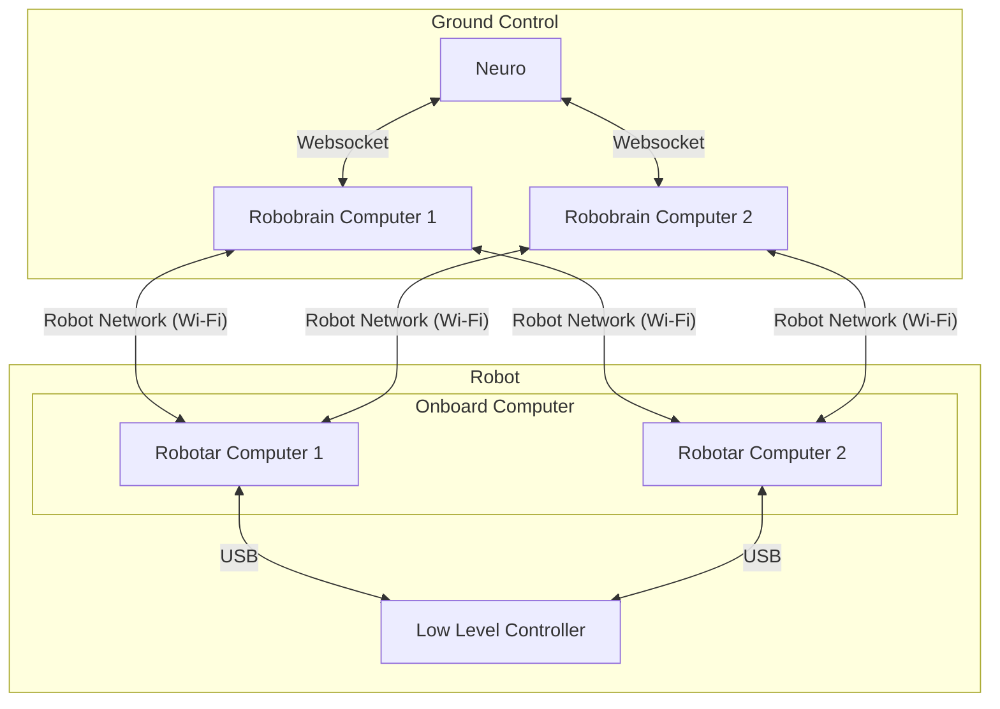
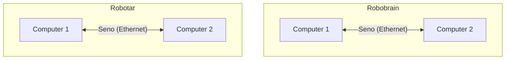

# Control System

## Low Level Control

### Field Oriented Control

For BLDC motor, there exists a lot of different way to drive it. The one that maximizes the efficiency with open implementation however is Field Oriented Control (FOC). We plan to use <a href="https://simplefoc.com/" target="_blank">SimpleFOC</a> library to control the motor. The feedback used for the FOC is a hall sensor, but current sense is also used to estimate the stator winding temperature.

### CAN-FD

The sheer number of actuator to be controlled requires the need of communication bus. Since the chosen MCU have CANBUS controller with CAN-FD support, it is what being used. The supporting component required is low or the same with other bus communication protocol considered (MODBUS) and the pros outweighted the cons. Namely, the CANBUS have low current draw on idle state compared to other bus, have higher speed, and built-in arbitration.

## High Level Control

To control and pilot the body, Neuro-sama language model doesn't necessarily have the capabilities to directly give command to each individual actuator/muscle. In order for the language model to be able to pilot the robot, an integration is needed that will give the language model the necessary control over the robot. This high level control will communicate with the language model to achieve the desired robot movement. With that in mind, the high-level model also have certain requirement to be met. Some of the requirement is as follows:

- Robust since failure in the high level control will cascade down to the low-level controller
- Low-latency to keep up with the real-world interaction
- Feedback for the language model so the language model will have rich context about the robot state

To achieve that goal, the proposed control scheme is best explained in a diagram below:

And this is how the redundant system will be orchestrated:

- [Robot Network (Transport using ad-hoc wi-fi network)](https://github.com/SimLeek/robot_network)
- [Seno (The redundancy orchestrator)](https://github.com/SimLeek/seno)

Neuro-sama already have the capabilities to take image input as vedal mentioned. However, the high-level controller will need the camera feed to be further processed before it can be used. This is also true for other sensor data such as microphone, limb position, and touch sensor. The high-level controller will likely be a system comprised of interdependent neural-network model due to the complexity of the robot.

