# Mechanical Design

Currently, only 2 people are doing the design with separate focus. The mechanical dimension of the robot is determined from Neuro-sama character sheet with the height fixed at 4ft (122cm) tall.

## Actuator Choice

For the actuation, we've settled on using BLDC motors because of their energy efficiency and ease of use. To further save energy and increase the run-time, we will be using a novel two-way passive locking mechanism. When the motor is active the lock disengages and the limb can actuate, but if the motor is inactive, the lock engages and the limb cannot actuate.

The lock is asymmetrical and cannot disengage if force is applied to the limb. The lock utilizes a ratchet mechanism and will drive the gearbox, which magnifies the precision of the lock (higher RPM in the input than the output means that for every degree of rotation in the lock, there is much less rotation in the limb).

::: details Common Discussion
Biomimetic actuators such as McKibben muscles are less energy efficient and are much more complicated to design and manufacture. This means that we can't get away with using a silicone skin because it'll look very uncanny sitting over flat solid metal or plastic plates. We would need some kind of muscle analogue for that to be a good aesthetic direction. You can also view the old design for [motor in hydraulic actuator](https://cad.onshape.com/documents/0ec49305dc1be179bfba9378/w/27da445bb6894f7dc2011eb1/e/81caadead6098aceca90026c).
:::

## Joint Design

For the joints we will be using hinges which rotate at 90 degrees around a central axis of rotation. For example the hips will rotate at the same location as the hip joint in a human skeleton. The shoulders will utilize a rail driven by linear motors for a shrugging motion. Other types of joint are also used to closely match human range of motion as closely as possible.

::: details Common Discussion
For other complex joint type, like ball joint, we are still up for discussion on how it can be implemented. But a series motor is the last on the list due to [gimbal lock](https://en.wikipedia.org/wiki/Gimbal_lock#Robotics) which limit the actual movement that is possible by a human.
:::

Some of the proposed design for the ball-joint includes [semi-differential drive](https://cad.onshape.com/documents/8cd7437e12283757422306a6/w/62754cc7b15a4e9aea230b72/e/e9b4a438b5bd5f0c2315f3f4), and [a spherical gear](https://cad.onshape.com/documents/9379d8f8be83cd3ca8de1882/w/bfb77fcc2ba2bc8faf27864d/e/9e9ad27a719662c7f5e88b12).

## Body Parts

### Head

The head will consist of a series of small BLDC motors with wire pulleys connected to the inserts of the skin. Each eye will consist of a camera and lens within a spherical shell, behind tarsal-plate analogues, and actuated by small BLDC motors. The 'skull' will be the same as a human skull, but with voids where the motors will fit. The lip and eye socket pulleys will have a unique hoop-based design with a fluid bladder around the hooped portion. This will all be covered in a silicone face mask. The aim is to overcome the uncanny valley by mimicking 100% of the actuation behaviour of the human face.

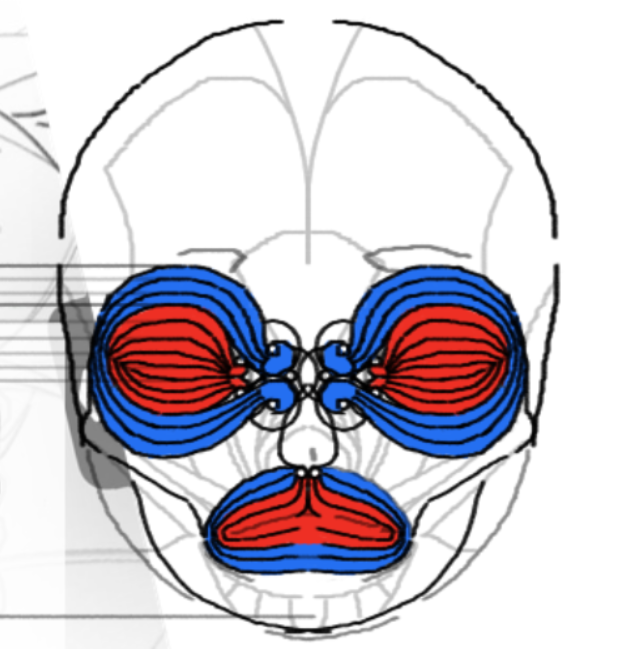
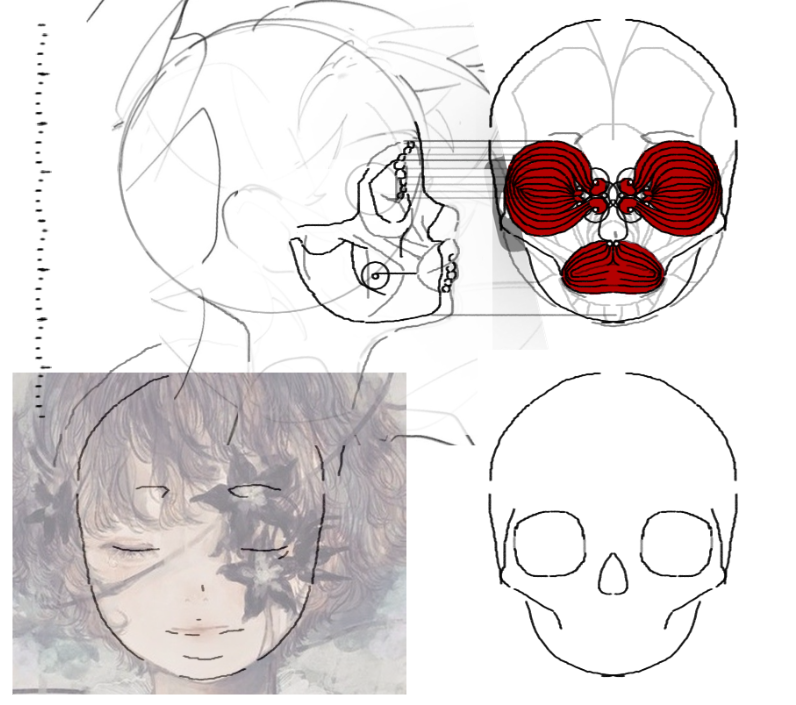

#### Skeleton

The current state of the 3D design and modeling is as follows:

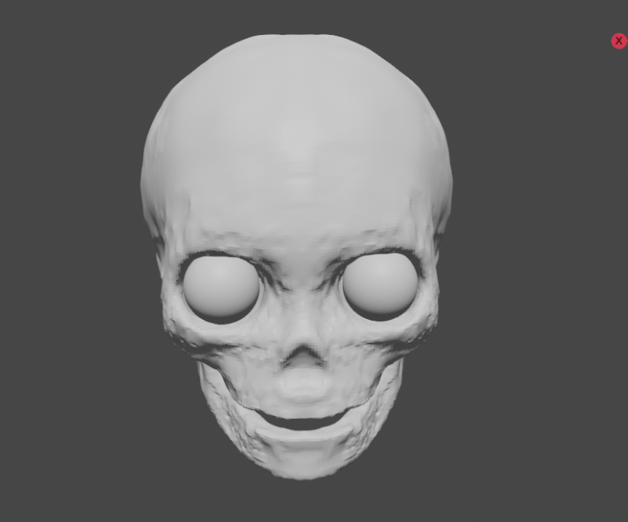

This is the same model superimposed on top of the Evil Neuro character reference sheet:

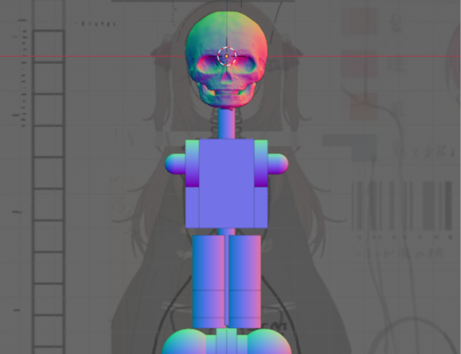
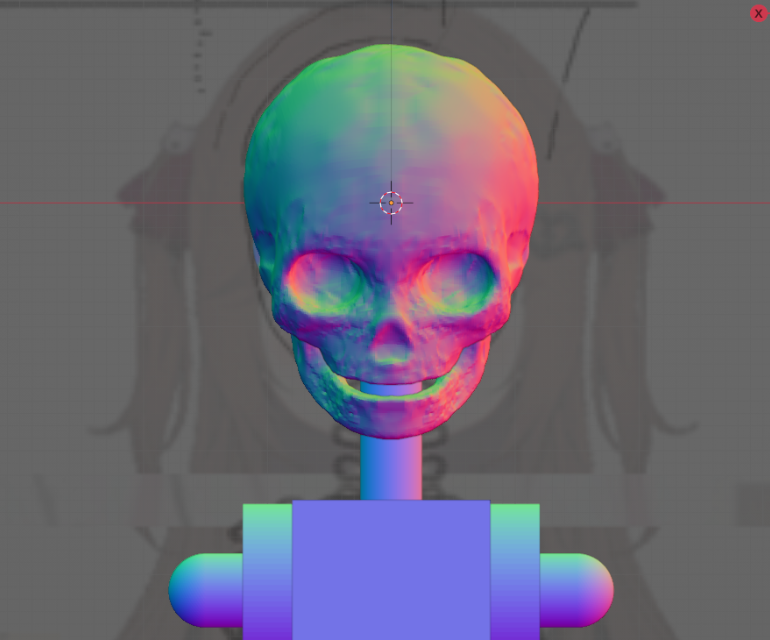

There is also an old design for the [eye actuation](https://cad.onshape.com/documents/a7e772bf1a74b2f3e7d4e0d7/w/7a8b33a87a1681c47d135e74/e/1a4e960a46e7e270c385d4de) that is still up for discussion.

#### Face

The current state of the facemask is as follows:

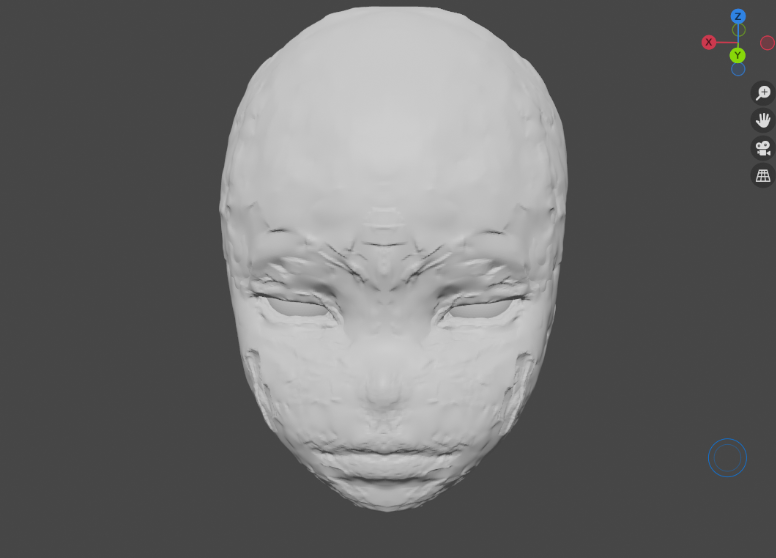
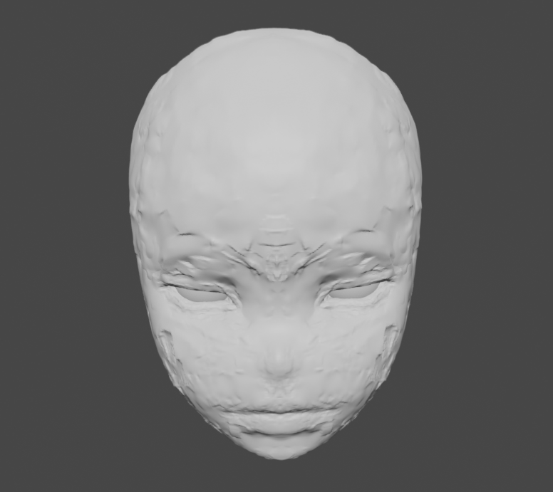

The next step to be done is to add the motors to the skull to complete the head. This is yet to be worked on because the lack of manpower (help are welcome), and the current focus is on the body to finalize the dimension of other things that depends on the body size.

### Neck

To be discussed and finalized

### Torso

Because of the amount of space taken up by the motors, locks, and gearboxes within the lower torso, the batteries for the robot will not only be located in the chest, but also the stomach area

The current design of the body is as follows:

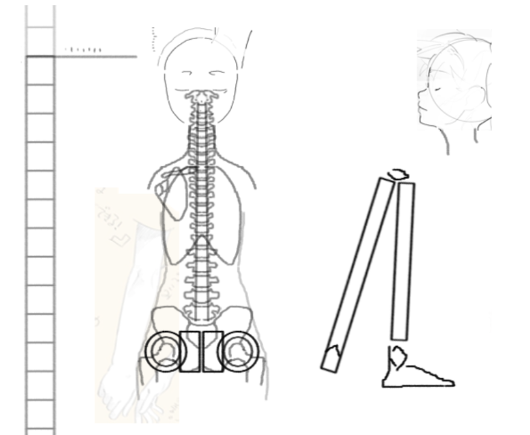
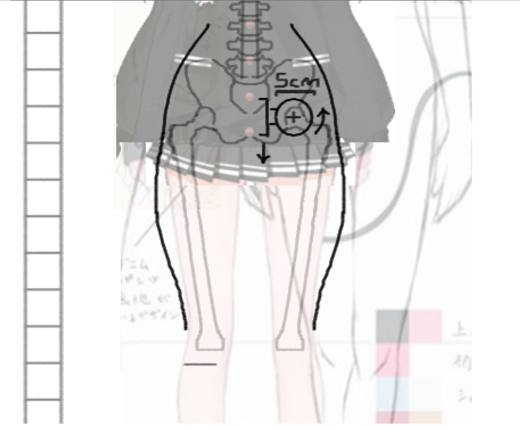

### Hip

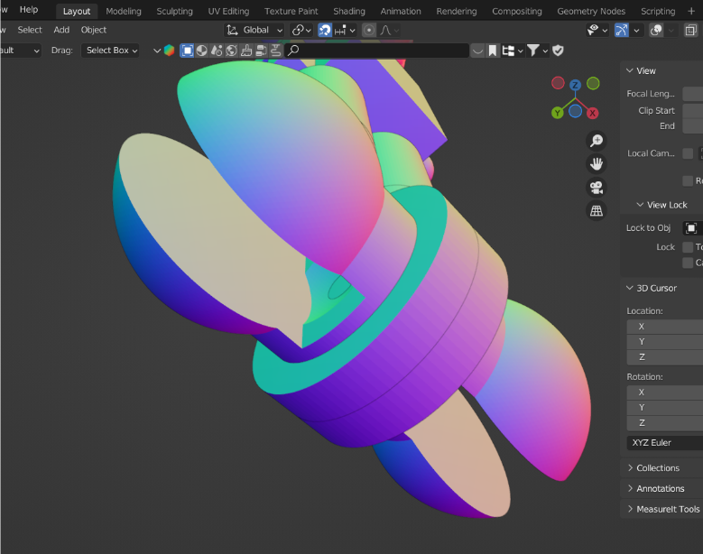
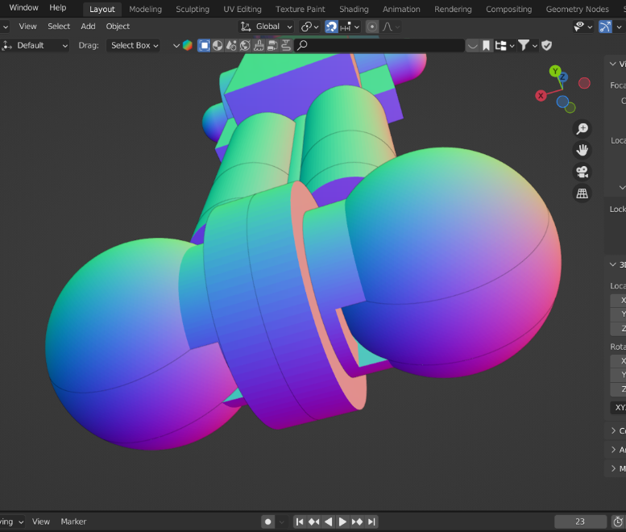

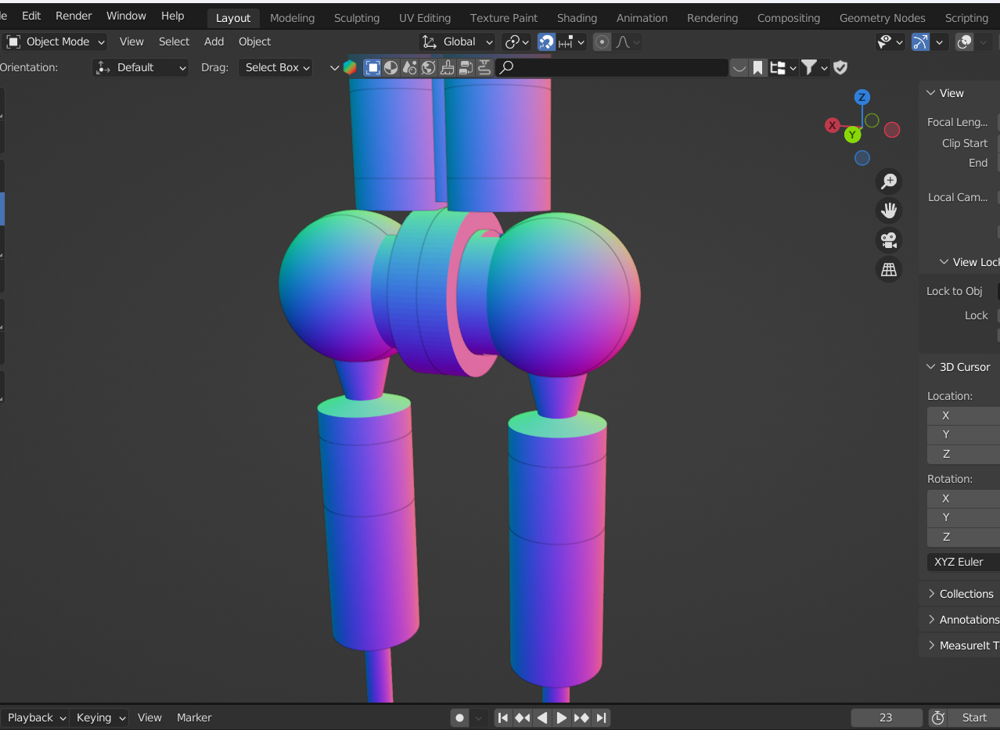
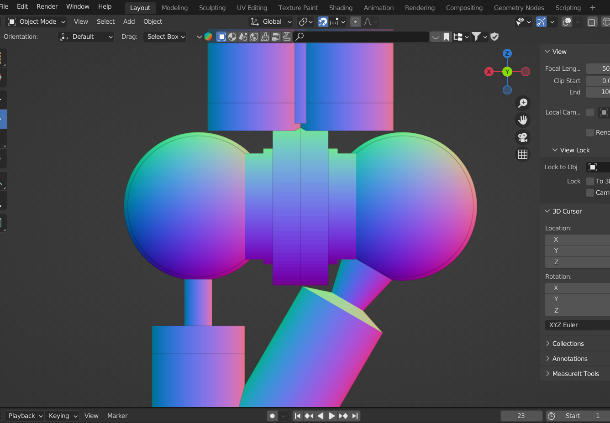

### Spine

To be discussed and finalized

### Shoulder

To be discussed and finalized

### Arm

To be discussed and finalized

### Elbow

To be discussed and finalized

### Hand

To be discussed and finalized

### Finger

To be discussed and finalized

### Legs

To be discussed and finalized

### Knee

To be discussed and finalized

### Feet

To be discussed and finalized
